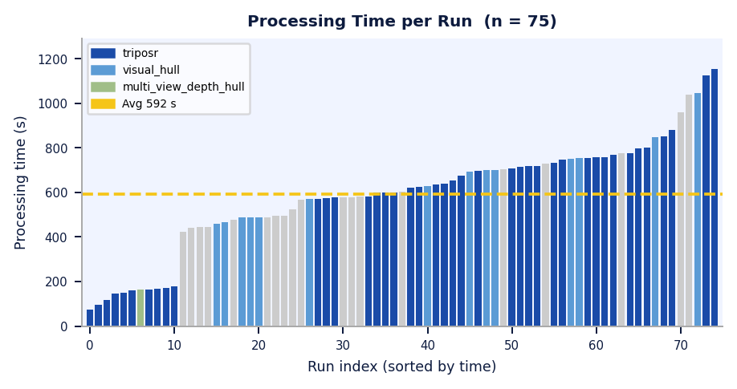

<div align="center">

# TriGenix
### Single-Image 3D Reconstruction Platform

**Turn one photograph into an interactive, textured 3D model — viewable in any browser, exportable for 3D printing, AR/VR, gaming and robotics.**


*Left to right: masked input photo → depth colour map → synthesised novel view → final mesh*

---

[](#)
[](#)
[](#)

</div>

---

## About This Project

TriGenix was developed as a final-year academic project at **Usha Mittal Institute of Technology, S.N.D.T. Women's University** under the guidance of **Prof. Sheetal Mhatre**.

**Team:**
- Shruti Vyavahare — [vshruti066@gmail.com](mailto:vshruti066@gmail.com)
- Sumedha Gamare — [sumedhagamare2005@gmail.com](mailto:sumedhagamare2005@gmail.com)

### My Contribution

I want to be transparent: this project was built using an AI-assisted development environment (Kiro IDE), which helped generate boilerplate code, suggest implementations, and speed up development. My personal contributions include:

- **System architecture decisions** — choosing TripoSR as the primary reconstruction backend, designing the fallback cascade, and structuring the three-layer frontend/backend/pipeline separation
- **Pipeline design and iteration** — defining the seven-stage processing pipeline and iterating on it through three development phases based on real output quality
- **Colour projection algorithm design** — specifying the region-based k-means approach, per-view calibration, colour-locking strategy, and the hue-conflict rejection fix
- **Testing and evaluation** — running 75+ reconstruction jobs, analysing results, identifying failure modes (orientation bug, side-view colour bleed), and directing the fixes
- **Research paper** — writing the IEEE-format paper documenting methodology, results and analysis
- **Problem diagnosis and debugging** — identifying root causes of visual artefacts and specifying targeted fixes
- **Product decisions** — scoping the 3D-printing workflow, 9 export formats, quality scoring, and confidence mapping

The codebase represents what I learned about computer vision pipelines, 3D reconstruction, and full-stack web development. I understand every component, can explain every design decision, and directed the development throughout.

---

## What It Does

```
Single photo  →  [Zero123++]  →  6 novel views
                                      ↓
                             [DPT-Large depth]  →  7 depth maps
                                      ↓
                    [TripoSR neural reconstruction]  →  raw mesh
                                      ↓
                     [Region-based colour projection]  →  textured mesh
                                      ↓
                      [Mesh repair + 9-format export]  →  GLB/STL/3MF/...
                                      ↓
                          [Three.js browser viewer]  →  interactive 3D
```

---

## Key Results

| Metric | Value |
|--------|-------|
| Evaluated models | 70+ |
| Watertight rate (print exports) | 100% |
| Mean silhouette IoU | 0.452 |
| Mean colour error | 5.7 / 255 units |
| Processing time (GPU) | 2 – 18 min |
| Export formats | 9 |
| Automated tests | 82 passing |


*Processing time across 75 real runs — colour-coded by backend (navy = TripoSR, light blue = visual hull)*

---

## Features

- **Single-image → 3D mesh** via Zero123++ multi-view synthesis + TripoSR neural reconstruction
- **Region-based colour projection** — k-means segmentation, per-view brightness calibration, hue-conflict rejection
- **Watertight output** — PyMeshFix repair, boundary-edge validation, guaranteed for all print exports
- **9 export formats** — GLB, STL, 3MF, AR/VR GLB, UV-textured GLB, LOD, Simulation, Collision OBJ
- **Interactive Three.js viewer** — orbit controls, shading modes, lighting presets, screenshot
- **Multi-user platform** — scrypt authentication, per-user history, share links
- **Integrated 3D-printing workflow** — slicer integration, dry-run and physical print dispatch
- **Quality scoring** — silhouette IoU, colour accuracy, mesh topology report
- **Real-time progress** — stage-by-stage status polling, ETA, cancellation
- **82 automated regression tests** — auth, upload, topology, mesh repair, end-to-end

---

## Tech Stack

| Layer | Technology |
|-------|-----------|
| Frontend | HTML / CSS / JavaScript, Three.js r128 |
| Backend | Python 3.11, `ThreadingHTTPServer` (no framework) |
| Reconstruction | TripoSR, Zero123++ (Diffusers), Intel DPT-Large (Transformers) |
| Background removal | rembg / u2net |
| Geometry | trimesh, PyMeshFix, scikit-image Marching Cubes |
| ML utilities | PyTorch (CUDA), NumPy, SciPy, scikit-learn |
| Database | SQLite |
| Testing | pytest (82 tests) |

---

## Project Structure

```
trigenix/
  server.py                 Main HTTP server + routing
  processor.py              Image preprocessing (rembg, Zero123++, DPT)
  reconstructor.py          3D reconstruction, colour projection, export
  auth.py                   Authentication, sessions, history, shares
  printer.py                3D print job management
  mesh_repair.py            Automatic mesh repair utilities
  pose_estimator.py         Input photo pose analysis
  quality_scorer.py         Six-category mesh quality scoring
  confidence_mapper.py      Per-vertex reconstruction confidence
  multi_angle_processor.py  4-angle capture mode
  cleanup_worker.py         Stale job cleanup daemon
  HTML/                     Frontend pages
  JS/                       Frontend JavaScript
  CSS/                      Stylesheets
  tests/                    82 automated tests
  paper/                    IEEE research paper (LaTeX)
  docs/                     Demo images and poster
  .env.example              Configuration template
  requirements.txt          Python dependencies
```

---

## Setup (Local)

```bash
# 1. Clone
git clone https://github.com/YOUR_USERNAME/trigenix.git
cd trigenix

# 2. Virtual environment
python -m venv venv
venv\Scripts\activate        # Windows
# source venv/bin/activate   # Linux/Mac

# 3. Install dependencies
pip install -r requirements.txt

# 4. Configure
cp .env.example .env
# Edit .env as needed

# 5. Download model weights
# Zero123++, DPT-Large, rembg/u2net: auto-downloaded on first run
# TripoSR: place checkpoint in weights/ (see weights/README.md)

# 6. Run
python server.py
# Open http://localhost:8000
```

**Minimum hardware:** Intel Core i5, 16 GB RAM, NVIDIA GPU 6 GB VRAM (CUDA 11.8+), 20 GB disk

---

## Running Tests

```bash
# Without GPU (fast)
set TRIGENIX_SKIP_HEAVY_TESTS=1
python -m pytest tests/ -q

# Full suite (requires GPU + weights)
python -m pytest tests/ -q
```

---

## Future Work

- **Live web deployment** — host on cloud GPU (AWS/GCP) for public access
- **InstantMesh integration** — replace TripoSR for higher fidelity and faster inference
- **Multi-angle capture** — accept 4 user photos for better geometry accuracy
- **WebXR/Unity export** — direct AR placement from browser
- **Mobile app** — Android/iOS capture and viewing

---

## Research Paper

An IEEE-format research paper documenting the system, methodology and evaluation results is in `paper/trigenix_paper.tex`.

---

## Academic Context

This project was submitted as a final-year project at Usha Mittal Institute of Technology, S.N.D.T. Women's University, Data Science & Engineering Department (2025–2026). It is shared here for portfolio purposes.

---

## Third-Party Licenses

| Component | License |
|-----------|---------|
| TripoSR | [VAST-AI-Research/TripoSR](https://github.com/VAST-AI-Research/TripoSR/blob/main/LICENSE) |
| Zero123++ | [sudo-ai-3d/zero123plus](https://github.com/sudo-ai-3d/zero123plus/blob/main/LICENSE) |
| Intel DPT-Large | Apache 2.0 |
| rembg / u2net | Apache 2.0 |
| trimesh | MIT |
| Three.js | MIT |
